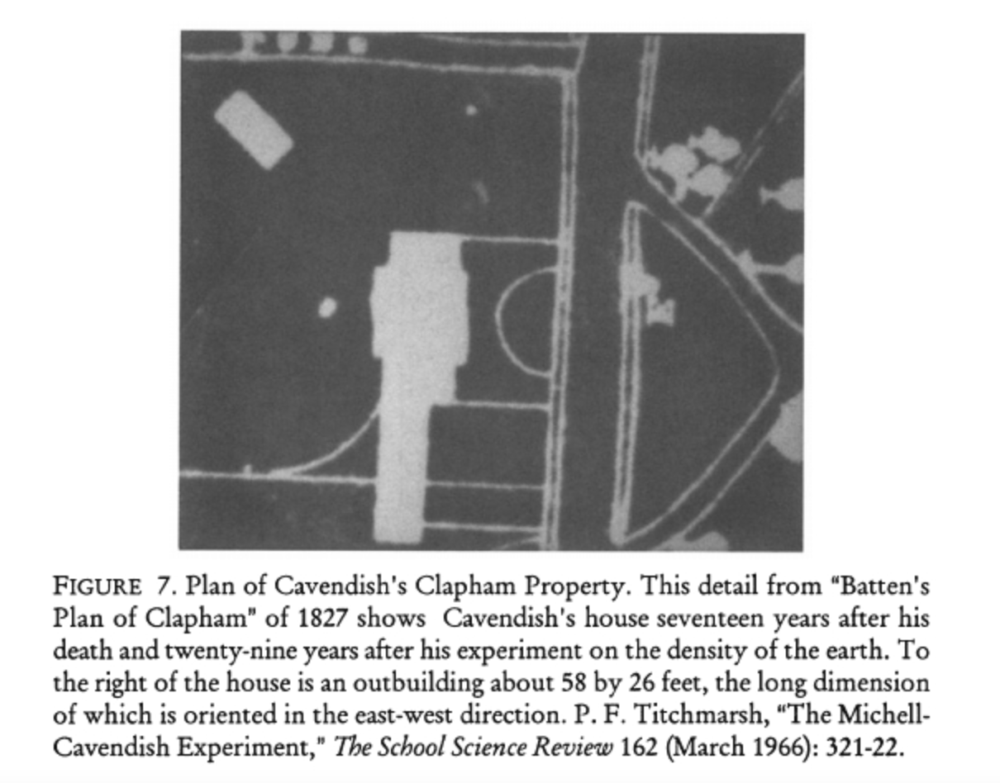

#+SETUPFILE: ~/.emacs.d/org-templates/level-0.org

* The building housing the experiment

  [Related: [[https://history.stackexchange.com/questions/68870/what-kind-of-building-materials-did-cavendish-use-in-determining-the-density-of][What kind of building materials did Cavendish use in determining the density of the earth?]] and [[https://hsm.stackexchange.com/questions/14405/the-housing-of-the-cavendish-experiment][The housing of the Cavendish Experiment]]]

 
# file:~/org/img/Cavendish-outbuilding-01.png

On page 490 of his [[https://royalsocietypublishing.org/doi/pdf/10.1098/rstl.1798.0022][article]], Cavendish writes:

#+BEGIN_QUOTE
My next trials were, to see whether this effect was owing to magnetism. Now as it happened, the case in which the arm was insclosed, was placed nearly parallel to the magnetic east and west, and therefore, if there was any thing magnetic in the balls and weights, the balls would acquire polarity from the earth...
#+END_QUOTE

The plan of Cavendish's house above shows an outbuilding with east-west alignment.

The plan is from [[https://www.jstor.org/stable/3152241?read-now=1&refreqid=excelsior%3A6494d878a67208a894db20fbadf71a13&seq=9][Mr. Cavendish Weighs the World
Russell McCormmach]].

McCormmach writes (p.362),

#+BEGIN_QUOTE
There is reason to think that the world was weighed not in the house but in a separate building. In his paper Cavendish referred to the magnetic orientation of the arm of his apparatus. A plan of Clapham Common made twenty-nine years after Cavendish’s experiment reveals a separate building aligned with respect to magnetic north-south.
#+END_QUOTE

The caption reads:

#+BEGIN_QUOTE
Figure 7. Plan of Cavendish’s Clapham Property. This detail from “Batten’s Plan of Clapham” of 1827 shows Cavendish’s house seventeen years after his death and twenty-nine years after his experiment on the density of the earth. To the right of the house is an outbuilding about 58 by 26 feet, [17.67 by 7.92 meters] the long dimension of which is oriented in the east-west direction. P.F. Titchmarsh, “The Michell-Cavendish Experiment,” The School Science Review 162 (March 1966): 321-22.
#+END_QUOTE

[It looks like McCormmach made a mistake regarding the alignment of the house. In the text he writes, "a plan of Clapham Common made twenty-nine years after Cavendish’s experiment reveals a separate building aligned with respect to magnetic north-south." But in the caption he writes, "to the right of the house is an outbuilding about 58 by 26 feet, the long dimension of which is oriented in the east-west direction." I believe the caption is correct.]
 
But there is a problem with the dimensions of the outhouse. In the cross section of the experiment, the building has dimensions of no more than 3.5 meters. 

file:/img/cavendish-image.jpeg

The dimensions of the outhouse do not match the dimensions Cavendish gave in his article. The building indicated in the map is far too big.

Cavendish clearly indicates in his article that his cross section is done to scale (p.473):

#+BEGIN_QUOTE
In these two figures, the different parts are drawn nearly in the proper proportion to each other, and on a scale of one to thirteen.
#+END_QUOTE

In my printout of the cross section, the building measures, wall to wall, 317 mm. I multiply this by 11 (not by 13 as Cavendish says) and the long side of the building turns out to be about 3.5 meters. Not knowing the scale of the map showing the outhouse I cannot confirm that the long side of the outhouse is over 17 meters.

** Another map of Clapham Common showing Cavendish's house (1877)

(Shared by [[https://hsm.stackexchange.com/a/14407/16575][njuffa]]):

file:/img/Lambeth-map.png

It would have been nice to know the scale of this map to calculate the size of the house. Unfortunately, they printed "Cavendish House" right on the garden so we do not see what is on the garden. This map is from 79 years after the experiment.
